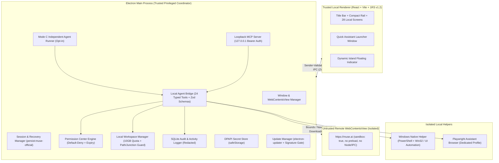

# ARCHITECTURE.md — System & Security Architecture

**Product:** Muse for Windows v1.0.0 — 1MS Studio (1RS v1.2)

---

## 1. High-Level Process & Trust Boundary Topology



---

## 2. Directory Layout

```text
muse-for-windows/
├── .github/                  # CI, Security, Dependency Review, Windows Release workflows & templates
├── DESIGN-SYSTEM/            # 1MS Studio 1RS v1.2 specs, DESIGN-TOKENS.json, Lucian map & ui-kit docs
├── docs/                     # Research, parity, security, privacy, licensing, user & build guides
├── integrations/             # Muse URL/session policies, MCP protocol definitions, Mode C adapters
├── native/
│   └── windows-helper/       # Parameterized PowerShell + C# Win32/UIA helper scripts
├── reports/                  # Phase reports, UI/Visual/A11y/Security/Performance/Publication audits
├── resources/                # Original SVG/PNG/ICO brand assets & bundled metadata
├── scripts/                  # Icon generator, secret scanner, SBOM & SHA256 release generators
├── src/
│   ├── main/                 # Electron Main process modules (windows, tray, shortcuts, bridge, security...)
│   ├── preload/              # Narrow contextBridge API for trusted local renderer only
│   ├── renderer/             # React 19 + Tailwind + Lucian UX/UI adapted components + 28 screens
│   └── shared/               # Branding config, constants, TypeScript types, Zod IPC/tool contracts
└── tests/                    # Unit, integration, security, visual QA & E2E suites
```

---

## 3. Core Security Invariants

1. **Zero Shared Context with Remote Content:** `https://muse.ai` runs in a dedicated `WebContentsView` with `sandbox: true`, `contextIsolation: true`, `nodeIntegration: false`, `webSecurity: true`, `allowRunningInsecureContent: false`, and **no preload script**.
2. **Sender Origin Verification:** Every `ipcMain.handle` call verifies that `event.sender` belongs to a trusted local `BrowserWindow` (`mainWindow` or `quickAssistantWindow`) and that `event.senderFrame.url` starts with the local `file://` bundle or `ELECTRON_RENDERER_URL` in dev.
3. **Filesystem Containment:** `WorkspaceGuard` resolves canonical paths via `fs.realpathSync.native`, rejects UNC paths (`\\`), rejects sensitive system/credential directories (`.ssh`, `AppData\Local\Google\Chrome`, `AppData\Local\Microsoft\Edge`, `Windows`, `System32`, `.gnupg`, `.aws`), and inspects NTFS `ReparsePoint` attributes so junctions/symlinks cannot escape `%USERPROFILE%\Documents\Muse` or explicitly approved folders.
4. **Loopback-Only Transport:** The optional local MCP HTTP server binds exclusively to `127.0.0.1` with cryptographic per-session Bearer token authentication, `Origin`/`Host` validation (DNS-rebinding & CSRF defense), and rate limiting.
5. **Secret Redaction:** Secrets live only in Windows DPAPI via Electron `safeStorage`; exported settings and SQLite activity logs automatically strip tokens, keys, cookies, Authorization headers, and sensitive payloads.
