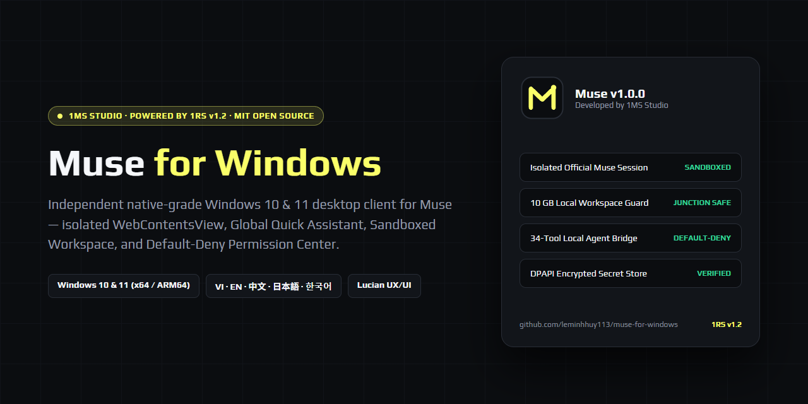
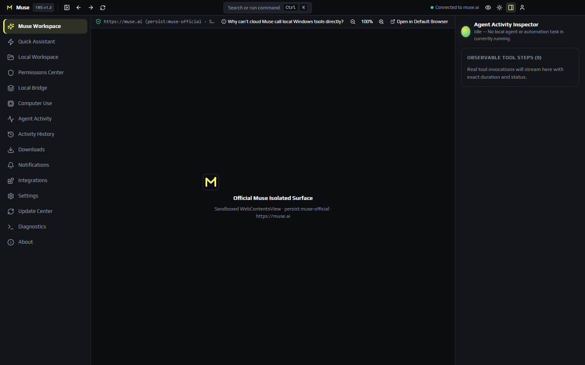
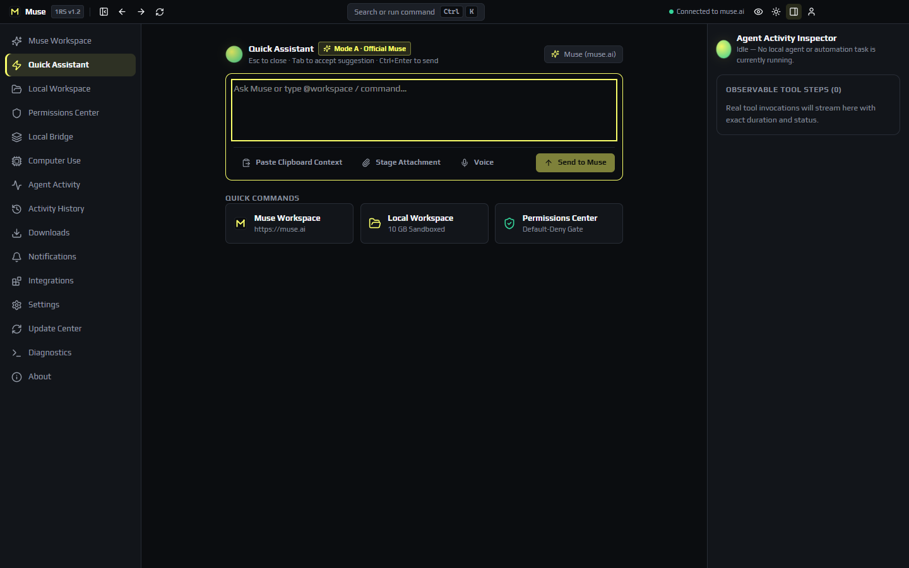
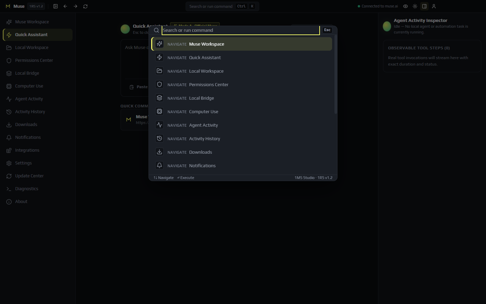
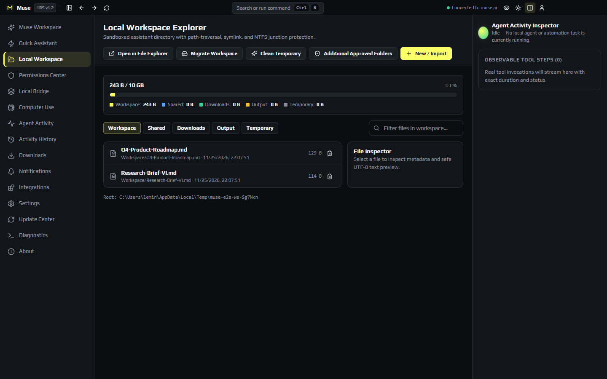
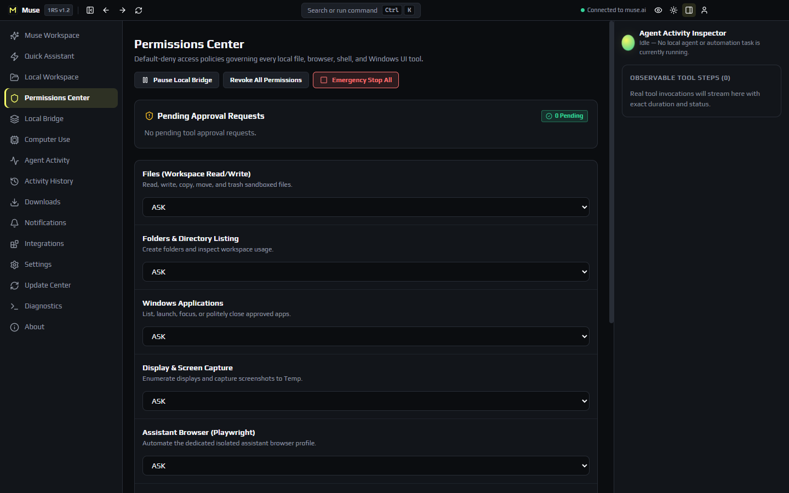
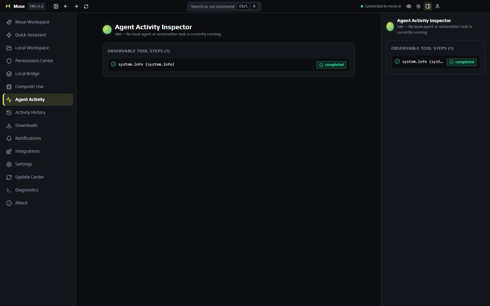
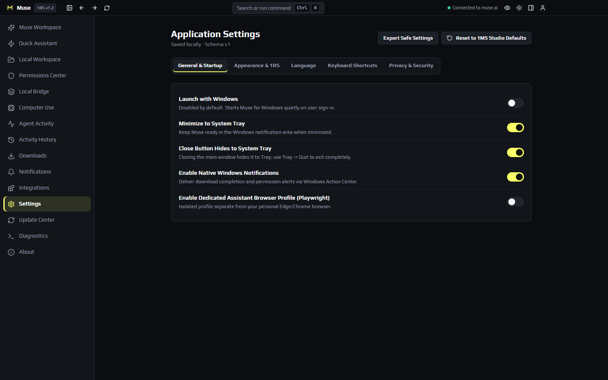
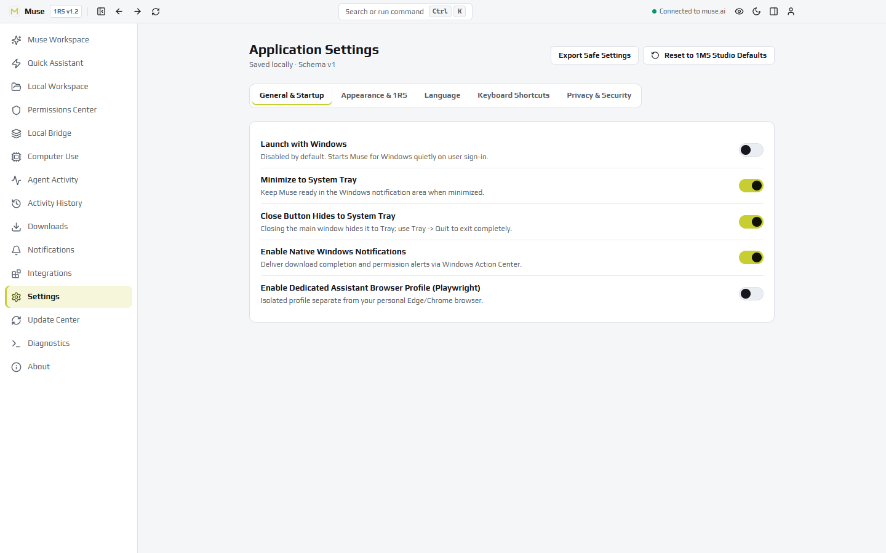
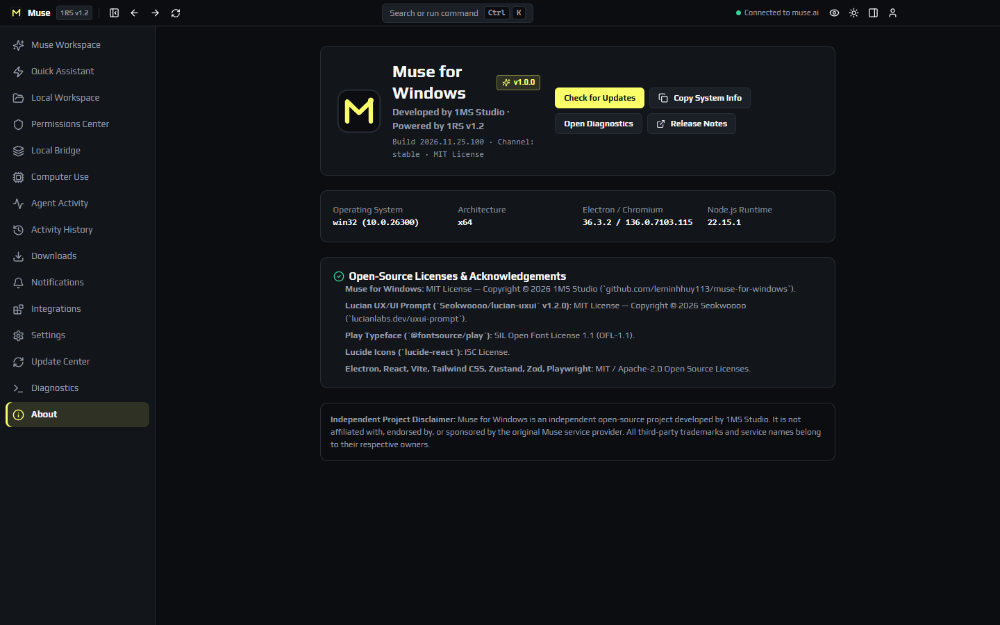

<div align="center">


# Muse for Windows

**An independent open-source Windows desktop client for Muse, featuring native Windows integration, secure local tools, multilingual support, and a premium 1MS Studio interface.**

[**English**](./README.md) · [**Tiếng Việt**](./README.vi.md)

[](https://github.com/leminhhuy113/muse-for-windows/releases)
[](./LICENSE)
[-60A5FA?labelColor=0B0D10)](./docs/COMPATIBILITY.md)
[](./DESIGN-SYSTEM/README.md)
[](https://github.com/leminhhuy113/muse-for-windows/actions/workflows/ci.yml)

</div>

---



## Overview

**Muse** (`https://muse.ai`, by Meta Platforms, Inc.) officially provides a native desktop client exclusively for **macOS** (Apple Silicon, macOS 15+), leaving Windows 10 and Windows 11 users limited to browser tabs.

**Muse for Windows** — engineered by **1MS Studio** on the **1RS v1.2** design standard — delivers a fast, security-first, native-feeling Windows desktop workspace that combines:

- **Official Muse Experience (Mode A):** Isolated, sandboxed `WebContentsView` (`persist:muse-official`) preserving your real Muse account, Conversations, **Feed**, **Ideas**, **Goals**, **Library**, **Connectors**, and **Cloud Computer (Secure VM)** — with zero credential interception and zero extra API keys required.
- **Native Windows 10 & 11 Shell:** Custom `38px` title bar with native `titleBarOverlay` & **Snap Layouts (`Win+Z`)**, System Tray, Jump Lists, Global Keyboard Shortcuts (`Ctrl+Alt+M`, `Ctrl+Alt+Space`), and Native Toast Notifications.
- **Quick Assistant Launcher:** Instant keyboard-first prompt composer with `@workspace` mentions, ghost suggestions, voice trigger, and legitimate clipboard/focus handoff to official Muse (or optional Mode C local agent execution).
- **Sandboxed Local Workspace (`10 GB` Default Quota):** Path-traversal, symlink, and **NTFS junction** escape guards, segmented storage meter, Windows Recycle Bin deletion, and SHA-256 verified workspace migration with automatic rollback.
- **Default-Deny Permission Center & 34-Tool Local Agent Bridge:** Granular policies (`Disabled`, `Deny`, `Ask every time`, `Read only`, `Allow in scope`), 45-second expiring approval dialogs, Emergency Stop, Loopback-only `127.0.0.1` MCP server, dedicated-profile Playwright browser automation, experimental Windows UI Automation Computer Use, and sanitized **SQLite** audit logging.
- **Multilingual Out of the Box:** Full support for **Vietnamese (`Tiếng Việt`, Unicode NFC)**, **English**, **Simplified Chinese (`简体中文`)**, **Japanese (`日本語`)**, and **Korean (`한국어`)** across Dark, Light, and System themes.

---

## Product Screenshots

| Main Desktop Workspace (Dark) | Quick Assistant Launcher |
|---|---|
|  |  |

| Command Palette (`Ctrl+K`) | Sandboxed Local Workspace |
|---|---|
|  |  |

| Default-Deny Permissions Center | Agent Activity Inspector |
|---|---|
|  |  |

| Settings (Dark Theme) | Settings (Light Theme) |
|---|---|
|  |  |

| About & Runtime Information |
|---|
|  |

---

## Capability & Compatibility Matrix

| Capability | Status | Notes |
|---|---|---|
| **Mode A: Official `muse.ai` Workspace** | **Verified Supported** | Isolated `WebContentsView` (`sandbox: true`, `contextIsolation: true`, no preload) |
| **Native Windows 10/11 x64 (`Setup` & `Portable`)** | **Verified** | Tested on Windows 11 x64 (`NT 10.0.26300.0`) |
| **Windows 11 ARM64 (`Setup` & `Portable`)** | **Cross-Compiled (Unverified)** | Built via Electron Builder; marked unverified until tested on physical ARM64 hardware |
| **Loopback MCP Server (`127.0.0.1:43821`)** | **Implemented Locally** | Bearer-authenticated JSON-RPC 2.0 for local MCP clients (e.g., `Muse Code` CLI) |
| **Mode B: Direct Cloud `muse.ai` -> Local Windows Bridge** | **Requires Official Integration** | Consumer `muse.ai` executes in Meta's cloud Secure VM; public tunnels are never auto-opened |
| **Mode C: Independent Local Agent (Ollama / OpenAI-Compatible)** | **Optional (Disabled by Default)** | Uses Windows DPAPI (`safeStorage`) for user API keys + shared Permission Center |
| **Windows UI Automation Computer Use** | **Experimental (Disabled by Default)** | Restricted to allowlisted apps; blocks UAC, lock screen, CAPTCHAs & password fields |

---

## Download & Installation

Download verified binaries from [**GitHub Releases (`v1.0.0`)**](https://github.com/leminhhuy113/muse-for-windows/releases/tag/v1.0.0):

- **Installer (x64 — Recommended):** `Muse-for-Windows-1MS-Studio-v1.0.0-Setup-x64.exe` *(Per-user install, no Administrator rights required)*
- **Portable (x64):** `Muse-for-Windows-1MS-Studio-v1.0.0-Portable-x64.exe`
- **ARM64 Builds (Unverified Hardware):** `Setup-arm64.exe` & `Portable-arm64.exe`
- **Checksums & Supply Chain:** Verify downloads against `SHA256SUMS.txt` and `SBOM.cdx.json`.

```powershell
# Verify SHA-256 checksum in PowerShell before running
Get-FileHash .\Muse-for-Windows-1MS-Studio-v1.0.0-Setup-x64.exe -Algorithm SHA256
```

---

## Build from Source

```bash
git clone https://github.com/leminhhuy113/muse-for-windows.git
cd muse-for-windows
npm ci
npm run dev          # Launch development mode
npm test             # Run unit, integration & security tests (Vitest)
npm run build        # Build Main, Preload & Renderer bundles
npm run test:e2e     # Run Playwright Electron E2E & Visual QA suite
npm run dist:win:x64 # Package Setup-x64.exe & Portable-x64.exe
```

---

## Technology Stack & Design System

- **Desktop & Runtime:** Electron `36`, TypeScript `5.8` (`strict: true`), Node.js `node:sqlite`, Windows PowerShell/.NET UI Automation helper
- **Frontend & State:** React `19`, Vite `6` (`electron-vite`), Tailwind CSS `4`, Zustand `5`, Zod `3.25`
- **Design System (`1RS v1.2`):** **1MS Studio** Carbon surfaces (`#0B0D10`), Electric Lime (`#FAFF69`), locally bundled **Play** typography (`@fontsource/play` OFL-1.1), **Lucide Icons**, and adapted interactive patterns from [**Lucian UX/UI Prompt**](https://github.com/Seokwoooo/lucian-uxui) (`v1.2.0`, MIT License by Seokwoooo).

---

## Documentation

- [Vietnamese User Guide (`docs/USER-GUIDE-VI.md`)](./docs/USER-GUIDE-VI.md) · [English User Guide (`docs/USER-GUIDE-EN.md`)](./docs/USER-GUIDE-EN.md)
- [Architecture (`ARCHITECTURE.md`)](./ARCHITECTURE.md) · [Security (`docs/SECURITY.md`)](./docs/SECURITY.md) · [Privacy (`docs/PRIVACY.md`)](./docs/PRIVACY.md)
- [Local Bridge & MCP (`docs/LOCAL-BRIDGE.md`)](./docs/LOCAL-BRIDGE.md) · [Build Guide (`docs/BUILD-GUIDE.md`)](./docs/BUILD-GUIDE.md) · [Troubleshooting (`docs/TROUBLESHOOTING.md`)](./docs/TROUBLESHOOTING.md)
- [Contributing (`CONTRIBUTING.md`)](./CONTRIBUTING.md) · [Licensing (`docs/LICENSING.md`)](./docs/LICENSING.md)

---

## Roadmap

- **v1.0.0:** Initial open-source Windows release (Mode A Shell, Quick Assistant, Sandboxed Workspace, Permission Center, 34-Tool Local Bridge, Multilingual `VI/EN/ZH/JA/KO`).
- **v1.1.0 (Proposed):** Expanded keyboard macro profiles, multi-workspace profiles, and enhanced UI Automation inspector visualizations.
- **v1.2.0 (Proposed):** Official Muse desktop connector adoption if/when Meta publishes a documented third-party Windows integration specification.

---

## License & Independent Project Disclaimer

Released under the [**MIT License**](./LICENSE) — Copyright © 2026 **1MS Studio**.

> **Muse for Windows is an independent open-source project developed by 1MS Studio. It is not affiliated with, endorsed by, or sponsored by the original Muse service provider. All third-party trademarks and service names belong to their respective owners.**
