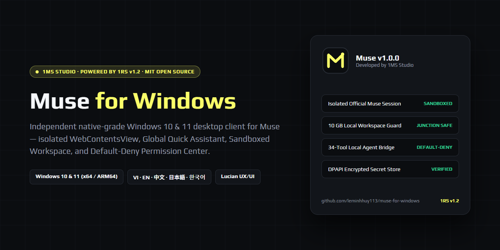
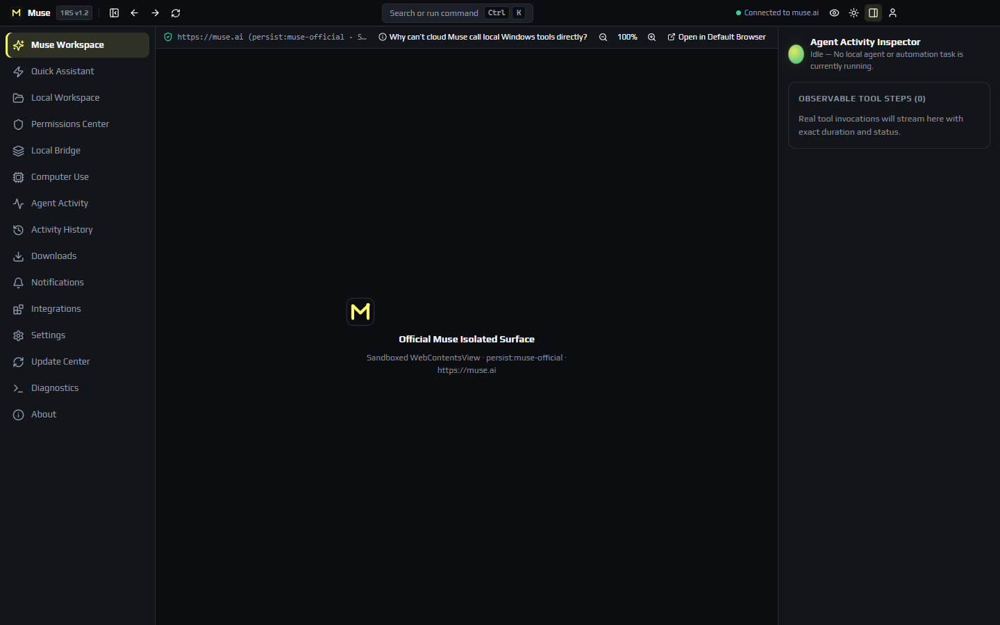
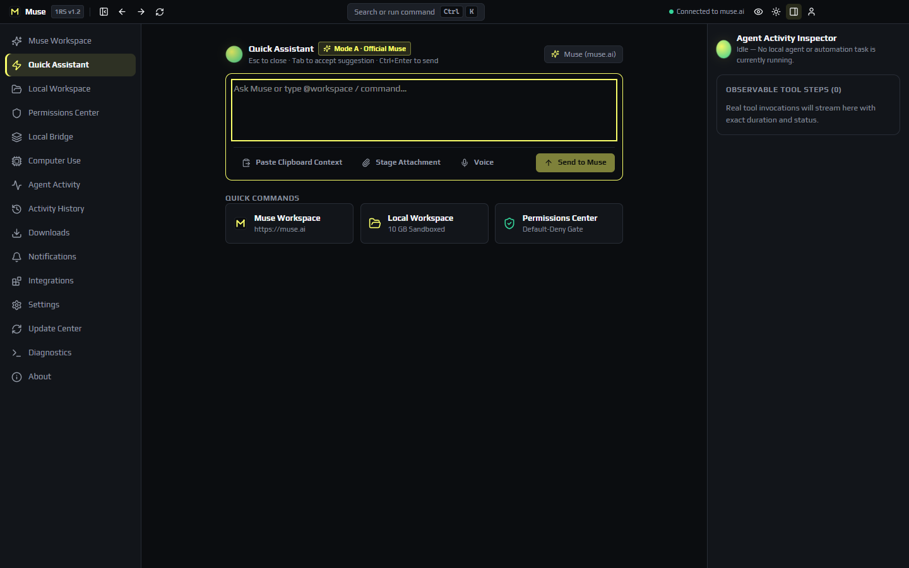
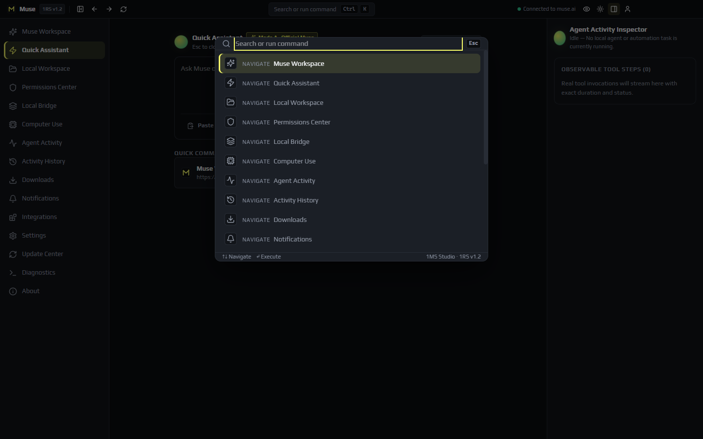
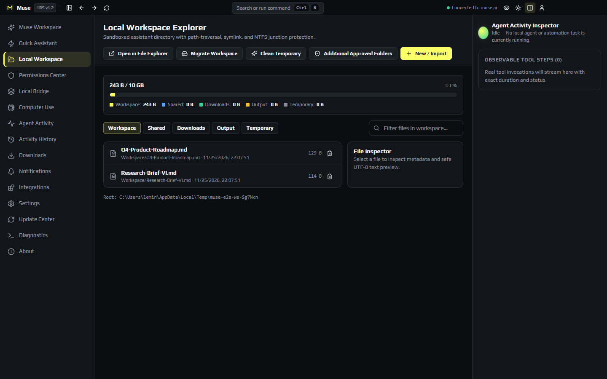
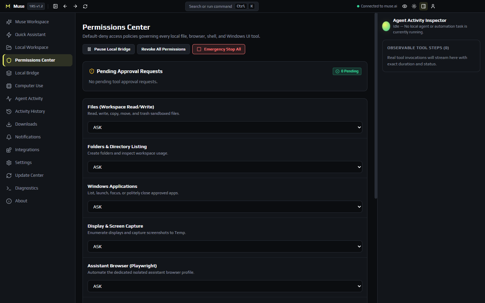
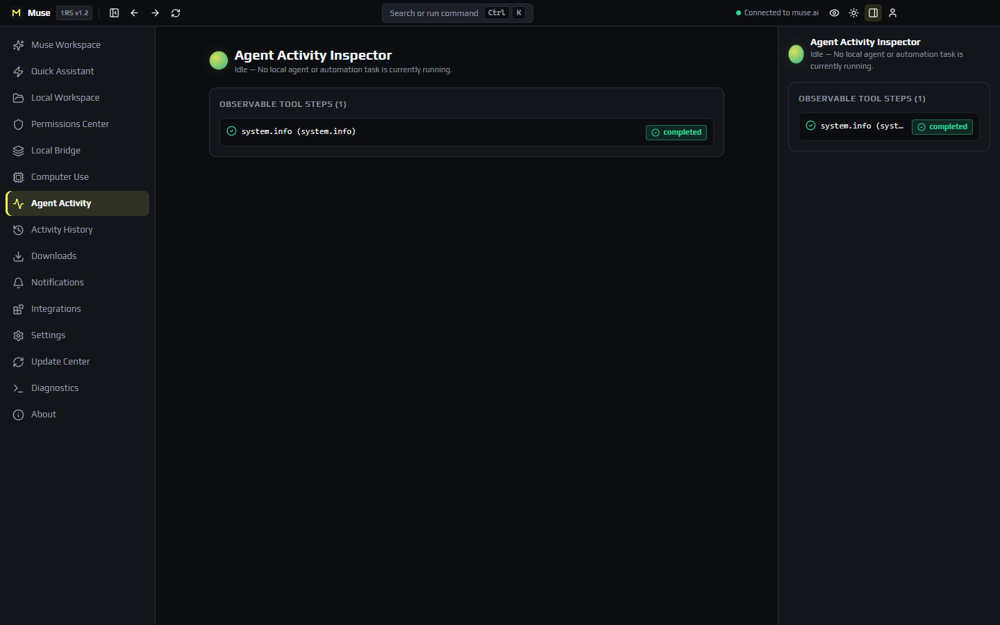
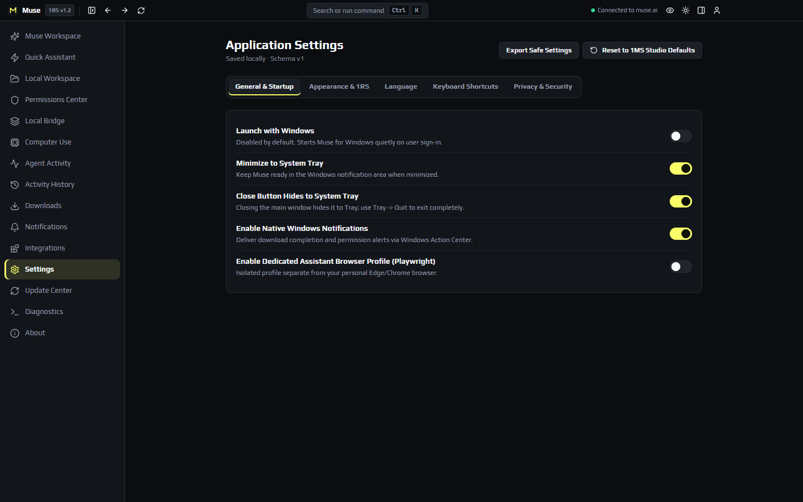
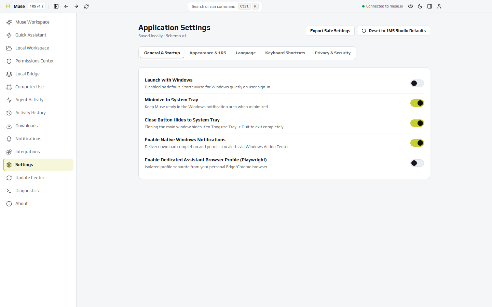

<div align="center">


# Muse for Windows

**Ứng dụng máy tính Windows mã nguồn mở độc lập dành cho Muse — tích hợp sâu hệ điều hành Windows, bộ công cụ cục bộ bảo mật, đa ngôn ngữ (Việt · Anh · Trung · Nhật · Hàn) và giao diện chuẩn 1MS Studio (1RS v1.2).**

[**English**](./README.md) · [**Tiếng Việt**](./README.vi.md)

[](https://github.com/leminhhuy113/muse-for-windows/releases)
[](./LICENSE)
[-60A5FA?labelColor=0B0D10)](./docs/COMPATIBILITY.md)
[](./DESIGN-SYSTEM/README.md)
[](https://github.com/leminhhuy113/muse-for-windows/actions/workflows/ci.yml)

</div>

---



## Tổng quan Sản phẩm

Hiện tại, **Muse** (`https://muse.ai`, phát triển bởi Meta Platforms, Inc.) mới chỉ phát hành ứng dụng máy tính chính thức dành riêng cho **macOS** (Apple Silicon, macOS 15+), khiến người dùng Windows 10 và Windows 11 chỉ có thể mở trên trình duyệt web.

**Muse for Windows** — phát triển bởi **1MS Studio** trên tiêu chuẩn thiết kế **1RS v1.2** — mang đến trải nghiệm trợ lý AI máy tính nguyên bản, tốc độ cao và ưu tiên bảo mật:

- **Trải nghiệm Muse Chính thức (Chế độ A):** Nhúng `https://muse.ai` trong `WebContentsView` cô lập (`persist:muse-official`), giữ trọn tài khoản thật, Hội thoại, **Feed**, **Ideas**, **Goals**, **Library**, **Connectors** và **Cloud Computer (Secure VM)** — không cần khóa API phụ, không can thiệp cookie hay mật khẩu.
- **Tích hợp Nguyên bản Windows 10 & 11:** Thanh tiêu đề `38px` đồng bộ `titleBarOverlay` & **Snap Layouts (`Win+Z`)**, Khay hệ thống (System Tray), Jump Lists, Phím tắt toàn cục (`Ctrl+Alt+M`, `Ctrl+Alt+Space`) và Thông báo Windows nguyên bản.
- **Trợ lý Nhanh (Quick Assistant):** Cửa sổ lệnh tức thì hỗ trợ `@workspace`, gợi ý thông minh (`Tab`), nhập giọng nói và chuyển tiếp hợp lệ sang Muse chính thức (hoặc chạy Tác tử Cục bộ Chế độ C).
- **Thư mục Làm việc Cô lập (`10 GB` mặc định):** Chống vượt cấp đường dẫn (`..`), chặn symlink & **NTFS junction**, thanh đo dung lượng trực quan, xóa an toàn vào Thùng rác Windows và di chuyển thư mục có đối chiếu mã băm SHA-256 kèm tự động hoàn tác khi lỗi.
- **Trung tâm Quyền hạn Mặc định Từ chối & 34 Công cụ Cục bộ:** Hộp thoại phê duyệt tự hết hạn sau 45 giây, nút **Dừng Khẩn cấp (Emergency Stop)**, máy chủ MCP `127.0.0.1` xác thực Bearer, tự động hóa trình duyệt Playwright hồ sơ riêng, Windows UI Automation (thử nghiệm) và nhật ký kiểm toán **SQLite** tự động ẩn dữ liệu nhạy cảm.
- **Hệ thống Đa ngôn ngữ:** Hỗ trợ sẵn **Tiếng Việt** (chuẩn Unicode NFC), **English**, **简体中文 (Tiếng Trung)**, **日本語 (Tiếng Nhật)** và **한국어 (Tiếng Hàn)** trên cả Giao diện Tối, Sáng và Theo hệ thống.

---

## Hình ảnh Thực tế từ Ứng dụng

| Không gian Muse Chính (Giao diện Tối) | Cửa sổ Trợ lý Nhanh (Quick Assistant) |
|---|---|
|  |  |

| Bảng Lệnh Nhanh (`Ctrl+K`) | Trình Quản lý Thư mục Cục bộ |
|---|---|
|  |  |

| Trung tâm Quyền hạn (Default-Deny) | Giám sát Hoạt động Tác tử |
|---|---|
|  |  |

| Cài đặt (Giao diện Tối) | Cài đặt (Giao diện Sáng) |
|---|---|
|  |  |

---

## Tải xuống & Cài đặt

Tải các bản thực thi tại trang [**GitHub Releases (`v1.0.0`)**](https://github.com/leminhhuy113/muse-for-windows/releases/tag/v1.0.0):

- **Bản Cài đặt Windows x64 (Khuyên dùng):** `Muse-for-Windows-1MS-Studio-v1.0.0-Setup-x64.exe` *(Cài đặt theo tài khoản người dùng, không cần quyền Admin)*
- **Bản Di động Windows x64 (Portable):** `Muse-for-Windows-1MS-Studio-v1.0.0-Portable-x64.exe`
- **Bản ARM64 (Biên dịch chéo — Chưa kiểm chứng trên phần cứng ARM64 vật lý):** `Setup-arm64.exe` & `Portable-arm64.exe`
- Kiểm tra mã băm an toàn trong tệp `SHA256SUMS.txt` và danh mục phần mềm `SBOM.cdx.json`.

---

## Tự Biên dịch từ Mã nguồn

```bash
git clone https://github.com/leminhhuy113/muse-for-windows.git
cd muse-for-windows
npm ci
npm run dev          # Chạy chế độ phát triển
npm test             # Chạy bộ kiểm thử đơn vị, tích hợp & bảo mật
npm run build        # Biên dịch Main, Preload & Renderer
npm run test:e2e     # Chạy kiểm thử Playwright Electron E2E & Visual QA
npm run dist:win:x64 # Đóng gói bộ cài Setup-x64.exe & Portable-x64.exe
```

---

## Tài liệu Chi tiết

- [Hướng dẫn Sử dụng Tiếng Việt (`docs/USER-GUIDE-VI.md`)](./docs/USER-GUIDE-VI.md)
- [Hướng dẫn Biên dịch (`docs/BUILD-GUIDE.md`)](./docs/BUILD-GUIDE.md) · [Xử lý Sự cố (`docs/TROUBLESHOOTING.md`)](./docs/TROUBLESHOOTING.md)
- [Kiến trúc Bảo mật (`docs/SECURITY.md`)](./docs/SECURITY.md) · [Quyền Riêng tư (`docs/PRIVACY.md`)](./docs/PRIVACY.md)
- [Cầu nối Cục bộ & MCP (`docs/LOCAL-BRIDGE.md`)](./docs/LOCAL-BRIDGE.md) · [Giấy phép (`docs/LICENSING.md`)](./docs/LICENSING.md)

---

## Giấy phép & Tuyên bố Dự án Độc lập

Phát hành theo [**Giấy phép MIT (MIT License)**](./LICENSE) — Bản quyền © 2026 **1MS Studio**. Ghi nhận sử dụng hệ thành phần tương tác [**Lucian UX/UI Prompt**](https://github.com/Seokwoooo/lucian-uxui) (`v1.2.0`, MIT License © 2026 Seokwoooo) và phông chữ **Play** (`OFL-1.1`).

> **Muse for Windows là dự án mã nguồn mở độc lập được phát triển bởi 1MS Studio. Ứng dụng không liên kết, không được chứng thực và không được tài trợ bởi nhà cung cấp dịch vụ Muse gốc. Mọi nhãn hiệu và tên dịch vụ bên thứ ba thuộc quyền sở hữu của chủ sở hữu tương ứng.**
